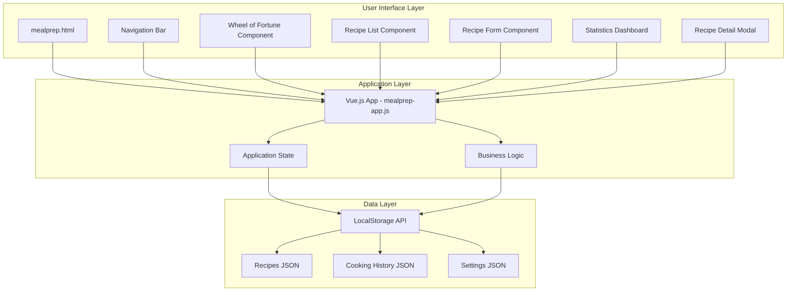
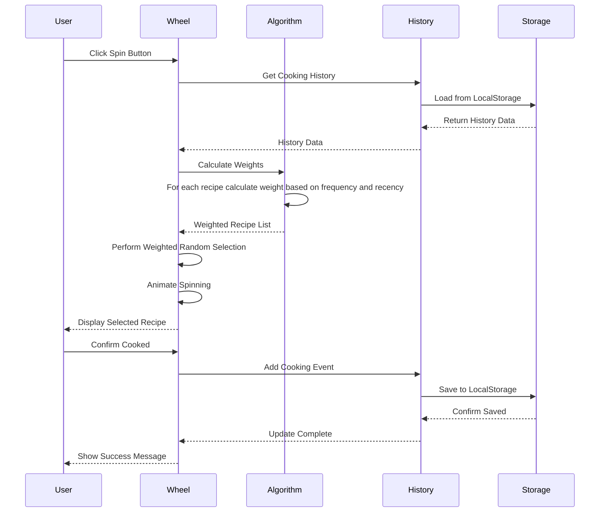
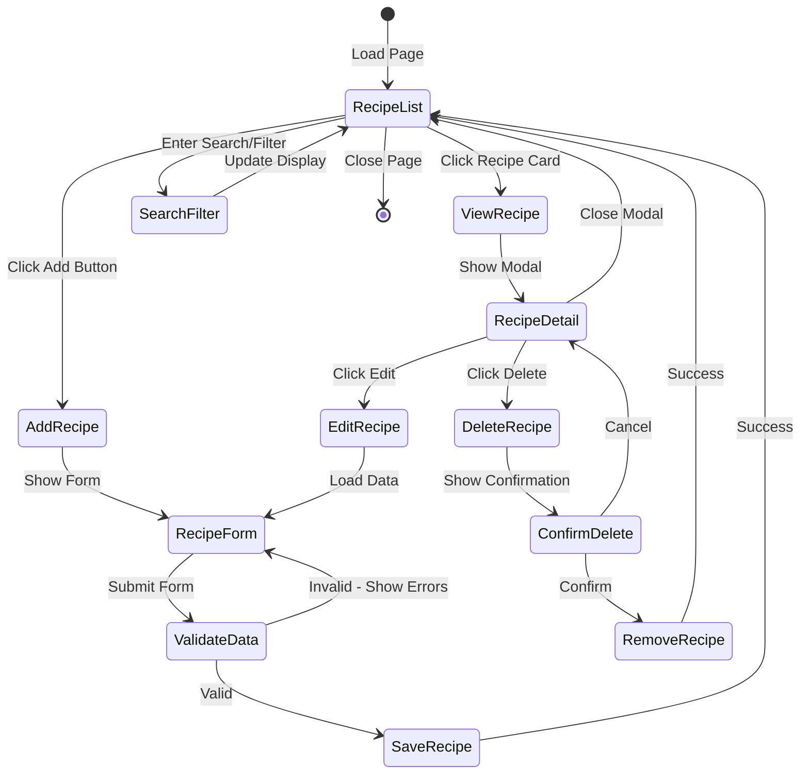
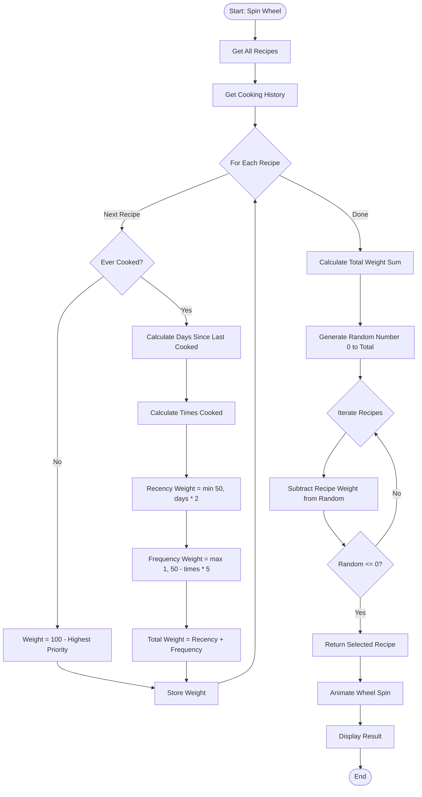
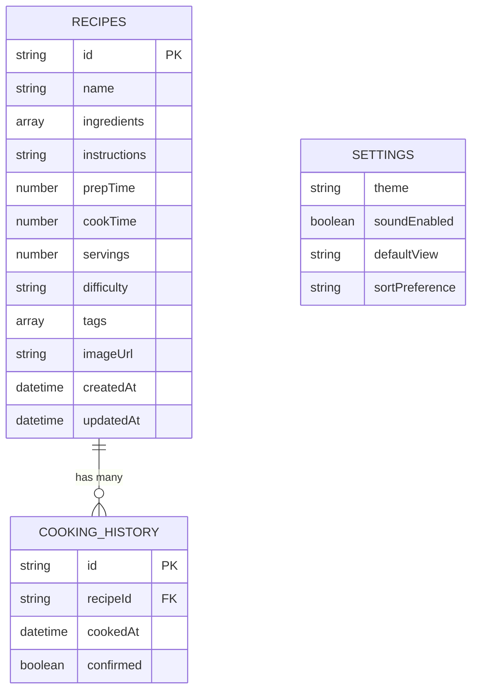

# Mealprep Module - System Architecture

## Component Architecture



## Data Flow - Wheel of Fortune



## Recipe Management Flow



## Smart Selection Algorithm Flow



## LocalStorage Structure



## Component Hierarchy

```
MealPrepApp (Root)
├── NavigationBar
│   ├── Logo
│   ├── ThemeToggle
│   └── BackButton
│
├── MainContainer
│   ├── WheelSection
│   │   ├── WheelCanvas
│   │   ├── SpinButton
│   │   ├── ResultDisplay
│   │   └── ConfirmButton
│   │
│   ├── StatisticsSection
│   │   ├── TotalRecipes
│   │   ├── TotalCooked
│   │   ├── MostCooked
│   │   └── LeastCooked
│   │
│   └── RecipeSection
│       ├── SearchBar
│       ├── FilterControls
│       ├── SortControls
│       ├── AddRecipeButton
│       └── RecipeGrid
│           └── RecipeCard (multiple)
│               ├── RecipeImage
│               ├── RecipeName
│               ├── DifficultyBadge
│               ├── TimeInfo
│               ├── TagList
│               ├── CookingStats
│               └── ActionButtons
│
├── RecipeFormModal
│   ├── FormFields
│   ├── IngredientsList
│   ├── TagsInput
│   └── SubmitButton
│
├── RecipeDetailModal
│   ├── RecipeHeader
│   ├── RecipeImage
│   ├── IngredientsList
│   ├── Instructions
│   ├── CookingHistory
│   └── ActionButtons
│
└── ExportImportModal
    ├── ExportButton
    ├── ImportInput
    └── ClearDataButton
```

## Key Features Implementation

### 1. Wheel of Fortune Animation
- Canvas-based rendering for smooth animation
- Easing function for realistic deceleration
- Sound effects on spin and selection
- Visual feedback during spinning

### 2. Smart Selection
- Weight-based probability distribution
- Considers both frequency and recency
- Ensures variety in meal selection
- Prevents repetitive cooking patterns

### 3. Data Persistence
- All data stored in LocalStorage
- Automatic save on every change
- Export/Import for backup
- Data validation on import

### 4. Responsive Design
- Mobile-first approach
- Touch-friendly interactions
- Adaptive layouts for different screen sizes
- Optimized wheel for mobile devices

## Performance Considerations

1. **Lazy Loading**: Recipe images loaded on demand
2. **Debouncing**: Search input debounced to reduce re-renders
3. **Virtual Scrolling**: For large recipe lists (future enhancement)
4. **Efficient Filtering**: Client-side filtering with optimized algorithms
5. **Minimal Re-renders**: Vue.js reactivity optimized for performance

## Security & Data Integrity

1. **Input Validation**: All user inputs validated before storage
2. **XSS Prevention**: Sanitize user-generated content
3. **Data Backup**: Regular export reminders
4. **Error Handling**: Graceful degradation on storage errors
5. **Data Migration**: Version checking for future updates